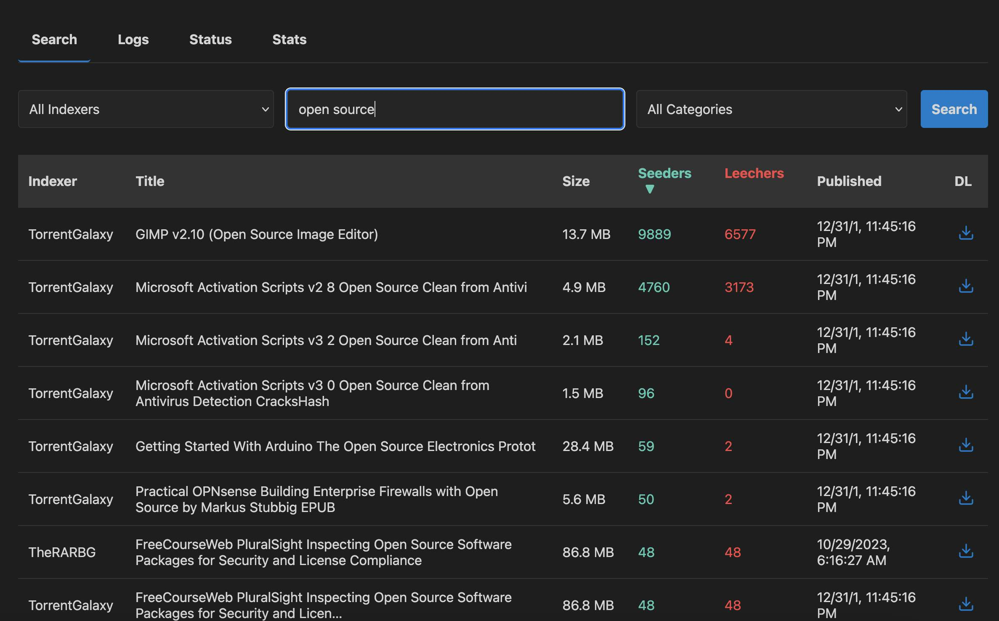

# Scarf

Scarf is a self-hosted meta-indexer that exposes public and private torrent trackers through a single Torznab API, driven by YAML definition files.

Part of [MangoStack](https://github.com/pixelotes/MangoStack), a self-hosted media stack for the Raspberry Pi.



## Footprint

Scarf is a single static Go binary (`CGO_ENABLED=0`) in a `scratch` image. Memory depends on which optional features are on:

- MangoStack runs it with `ENABLE_CRONJOBS=false`, `CACHE_ENABLED=true`, `MAX_CACHE_SIZE_MB=32` and `MAX_CONCURRENT_SEARCHES=3`, and measured about 11 MB RSS idle.
- The older "10-15 MB" figure was not tied to a specific configuration; other setups need re-measuring.

What pushes memory up:

- **Cron jobs** (`ENABLE_CRONJOBS`, default on): each indexer's `schedule` fetches its latest releases into the cache. Only runs when the cache is enabled too.
- **Cache** (`CACHE_ENABLED`, `MAX_CACHE_SIZE_MB`): SQLite cache; a bigger limit means more data held and touched.
- **Web UI** (`WEB_UI`): adds the authenticated API, the log WebSocket and stats.
- **Loaded definitions**: every definition in `DEFINITIONS_PATH` is kept in memory. From the Prowlarr catalog, only enabled indexers are loaded.
- **Concurrent searches** (`MAX_CONCURRENT_SEARCHES`): more parallel tracker requests during a search.

CPU is negligible at idle; searches are network-bound.

Disk writes:

- The SQLite cache at `DB_PATH`, only when `CACHE_ENABLED=true`. With the cache off, no database is opened.
- `indexers.yml` in `DATA_DIR`, when you toggle an indexer or save its settings. Definition files are never modified.
- The Prowlarr catalog in `DATA_DIR/upstream` (about 5 MB), only when you press "Update catalog".

## Features

- Torznab API per indexer (`/torznab/<key>`) and across all indexers (`/torznab/all`).
- YAML indexer definitions: JSON APIs, HTML scraping, and two-step scraping (results page, then details page for the magnet/download link).
- Multi-domain definitions (several `urls`).
- Private trackers: login with user/password (`login` block), custom headers, and per-indexer settings shown as a form in the web UI.
- Search modes per definition (`search`, `tv-search`, `movie-search`, `music-search`, `book-search`).
- Definitions are reloaded automatically when files in `DEFINITIONS_PATH` change.
- Optional SQLite result cache with a size limit, plus scheduled pre-fetch of latest releases.
- Automatic disabling of indexers after `MAX_FAILURES` consecutive failures.
- Per-indexer rate limit (`rate_limit` in the definition).
- Server-side filtering (`min_seeders`, `min_size`) and sorting (`sort`, `order`; seeders descending by default). See [docs/api_usage_and_sorting.md](docs/api_usage_and_sorting.md).
- Cloudflare-protected sites through a FlareSolverr-compatible service: [Parasol](https://github.com/pixelotes/parasol) (what MangoStack uses) or FlareSolverr. Enabled per indexer with its `use_flaresolverr` setting.
- Web UI: manual search, live logs, indexer status/tests, statistics, recent searches. Protected by a password; the Torznab API uses an API key.

## Quick start

Use the published `pixelotes/scarf:arm64` image, or build your own with `docker build -t scarf .`.

```yaml
services:
  scarf:
    image: pixelotes/scarf:arm64
    container_name: scarf
    restart: unless-stopped
    ports:
      - "8080:8080"
    volumes:
      - ./definitions:/app/definitions
      - ./data:/app/data
    environment:
      - UI_PASSWORD=change-me
      - FLEXGET_API_KEY=a-long-random-key
      - JWT_SECRET=a-long-random-secret
```

Scarf is then at `http://localhost:8080`. Inside MangoStack it is already wired in `docker-compose.yaml`.

## Configuration

All configuration is through environment variables (`config/config.go`). The effective values are logged at startup.

| Variable | Description | Default |
|---|---|---|
| `APP_PORT` | Listen port. | `8080` |
| `DEFINITIONS_PATH` | Directory with indexer definitions. | `./definitions` |
| `WEB_UI` | Enable the web UI and its authenticated API. | `true` |
| `UI_PASSWORD` | Web UI password (min 6 chars when the UI is on). **Set this.** | `password` |
| `FLEXGET_API_KEY` | Torznab API key (`apikey=` parameter). MangoStack maps `SCARF_API_KEY` to it. | random, regenerated on every start unless set |
| `JWT_SECRET` | Secret for signing web UI sessions. | random, regenerated on every start unless set (sessions end on restart) |
| `CACHE_ENABLED` | Enable the SQLite cache. | `true` |
| `DB_PATH` | SQLite cache file. | `./data/indexer-cache.db` |
| `CACHE_TTL` | Search result cache TTL (min `1m`). | `15m` |
| `LATEST_CACHE_TTL` | Latest-releases cache TTL (min `1h`). | `24h` |
| `MAX_CACHE_SIZE_MB` | Cache size limit (min 10). | `500` |
| `ENABLE_CRONJOBS` | Scheduled pre-fetch of latest releases (needs the cache). | `true` |
| `MAX_CONCURRENT_SEARCHES` | Parallel tracker searches. Lower uses less memory but is slower. | `4` |
| `MAX_FAILURES` | Consecutive failures before an indexer is disabled; `0` turns this off. | `5` |
| `REQUEST_TIMEOUT` | HTTP server/request timeout (min `1s`). | `20s` |
| `DEFAULT_API_LIMIT` | Results returned to clients that don't paginate. | `100` |
| `DATA_DIR` | Directory for `indexers.yml` and the downloaded catalog. | `./data` |
| `STATE_FILE` | Enabled flags and indexer settings, including credentials (written with mode 0600). | `$DATA_DIR/indexers.yml` |
| `UPSTREAM_SYNC` | Enable the Prowlarr definitions catalog in the web UI. | `true` |
| `UPSTREAM_URL` | Tarball the catalog is downloaded from. | Prowlarr/Indexers `master` |
| `FLARESOLVERR_URL` | FlareSolverr-compatible endpoint (Parasol or FlareSolverr), e.g. `http://parasol:8191`. | empty |
| `SKIP_TLS_VERIFY` | Skip TLS certificate checks (insecure). | `false` |
| `DEBUG` | Debug logging. | `false` |

Per-indexer settings can also be set as `<KEY>_<SETTING>` in upper case, e.g. `HDSPACE_USERNAME` for the `username` setting of the indexer with key `hdspace`. These override the defaults in the YAML and the values saved in `indexers.yml`.

The generated key and secret are 16 and 32 random bytes, hex-encoded. Pin `FLEXGET_API_KEY` if your clients store the Torznab URL.

## Usage

### Web UI

Open `http://<host>:8080` and log in with `UI_PASSWORD`. Sections:

- **Search**: search one indexer or all of them.
- **Logs**: live application logs.
- **Status**: indexer health, per-indexer tests, settings, and the Torznab URL to copy.

### Torznab API

Add Scarf as a Torznab indexer in Sonarr, Radarr, FlexGet, etc.:

```
http://<host>:8080/torznab/all?apikey=<FLEXGET_API_KEY>
```

Use an indexer key instead of `all` for a single tracker. Other endpoints: `/torznab/<key>/api`, `/torznab/<key>/latest`, `/health`. Full list in [docs/api_endpoints.md](docs/api_endpoints.md).

## Indexer definitions

Scarf runs [Cardigann](docs/cardigann.md) definitions, the format Jackett and Prowlarr use.

- **Catalog:** in the web UI, open **Indexers**, press **Update catalog** and **Add** the indexers you want. Scarf downloads the [Prowlarr/Indexers](https://github.com/Prowlarr/Indexers) definitions on demand; they are not bundled.
- **Local files:** `definitions/` holds the few sites Prowlarr does not cover. Drop any Cardigann `.yml` there (file name = `id`); it is loaded without a restart and wins over a catalog definition with the same `id`.

Enabled flags and settings live in `indexers.yml` (see [docs/cardigann.md](docs/cardigann.md)), never in the definition files.

Scarf's old definition format is no longer supported.

For sites that only show the magnet link on a details page, use `details_url` plus `download_selector` for a two-step search.

### Tips for low-end devices

- Disable the latest-releases jobs (`ENABLE_CRONJOBS=false`).
- Keep only the definitions you use (4 or 5); all loaded definitions stay in memory.
- Lower concurrent searches (`MAX_CONCURRENT_SEARCHES=2`).
- Disable the web UI if you don't need it (`WEB_UI=false`).
- Keep debug output off (`DEBUG=false`).
- Reduce the cache size (`MAX_CACHE_SIZE_MB=10`).
- As a last resort, disable the cache (`CACHE_ENABLED=false`).
- `GOGC=50` (as in the bundled `docker-compose.yaml`) lowers peak memory at some CPU cost.

## Building from source

```bash
go build -trimpath -o scarf .
./scarf
```

Requires Go 1.27 (see `go.mod`). Run from the repo root so `./definitions` and `./web` are found, or set `DEFINITIONS_PATH`.

## Limits

- Do not expose Scarf to the internet; it assumes a trusted LAN. The default `UI_PASSWORD` is weak and the API key travels in the URL.
- Outbound tracker requests use a fixed 20 s client timeout; per-tracker timeouts are not configurable.
- Definitions break when sites change their HTML; `tools/check` probes every tracker (run weekly in CI).
- Cloudflare-protected sites need Parasol or FlareSolverr.

### Planned

- Per-tracker timeouts.
- Health-check notifications (webhooks, Pushbullet).
- Skip indexers without the requested search mode on `/torznab/all`.

## Part of MangoStack

| App | Role |
|---|---|
| [Scarf](https://github.com/pixelotes/scarf) | Indexer proxy (Torznab) |
| [Parasol](https://github.com/pixelotes/parasol) | Optional Cloudflare solver for Scarf |
| [Reel](https://github.com/pixelotes/reel) | Movie & TV automation |
| [Tango](https://github.com/pixelotes/tango) | Web UI and REST API for aria2c |
| [RMS](https://github.com/pixelotes/rms) | Media server (Jellyfin API) |
| [Suika](https://github.com/pixelotes/suika) | Manga reader |
| [Kaze](https://github.com/pixelotes/kaze) | Music server (Subsonic API) |
| [Sumi](https://github.com/pixelotes/sumi) | EPUB reader |
| [Dashboarr](https://github.com/pixelotes/dashboarr) | Homepage |

## License

MIT
